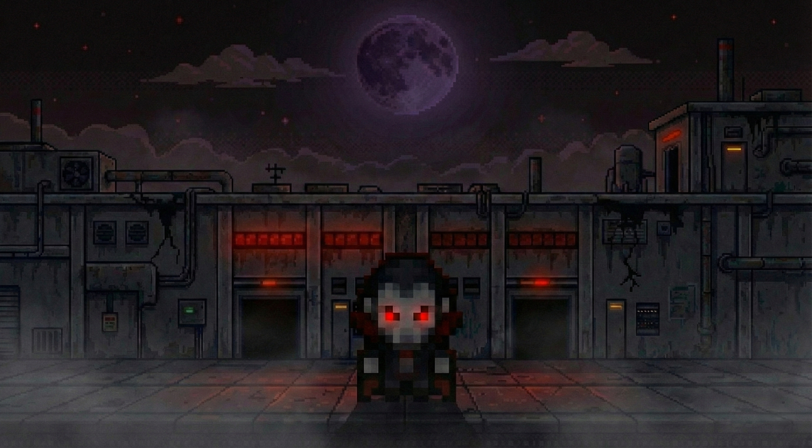

# Maze Runner



"Vampire in Berghain" is a top-down maze-runner game where you play as a recently awakened vampire. Trapped in Berghain, a club in Berlin, you must navigate through dangerous mazes, spill the blood of mortals, and find the portal that leads back to your home in Transylvania.

## Quick Start (Getting Started)

Follow these instructions to run the project locally on your machine.

### Windows
Open a terminal (Command Prompt or PowerShell) in the project root and run:
```bash
gradlew.bat desktop:run
```

### Mac
Open a terminal in the project root and run:
```bash
./gradlew desktop:run
```
*Note: The project is configured to use the `-XstartOnFirstThread` JVM argument, which is required for LWJGL3 applications on macOS.*

### Linux
Open a terminal in the project root and run:
```bash
./gradlew desktop:run
```

## Prerequisites

To build and run this project, you need:
- **Java Development Kit (JDK) 17 or higher**: Ensure your `JAVA_HOME` environment variable is set correctly.
- **Gradle**: The project uses the Gradle wrapper, so no manual installation is required.

## Project Structure

This project is built using **Java 17** and the **libGDX** framework, organized into a multi-module Gradle setup:

- **`core`**: Contains the main game logic, entity management, and shared code. It utilizes **gdx-vfx** for post-processing and **FreeType** for font rendering.
- **`desktop`**: The desktop launcher module using **LWJGL3**. It handles window creation and uses **gdx-nativefilechooser** for system file dialogs.
- **`assets`**: Stores all game resources, including textures, sound effects, music, and map files.

## JavaDoc
[JavaDoc](https://ilies1511.github.io/FoP_Project_Maze_Runner/)

## How to Build/Export

To create a standalone, runnable JAR file for the desktop version, execute the following command:

```bash
./gradlew desktop:dist
```

The generated JAR file will be located in the `desktop/build/libs/` directory. You can run it using:
```bash
java -jar desktop/build/libs/desktop-1.0.jar
```

## Controls

The following table lists the default key bindings for Maze Runner:

| Action | Key |
| :--- | :--- |
| **Move Up** | `W` |
| **Move Left** | `A` |
| **Move Down** | `S` |
| **Move Right** | `D` |
| **Attack** | `SPACE` |
| **Dash** | `Left Shift` |
| **Interact** | `E` |
| **Special Ability** | `Q` |
| **Progression Tree** | `I` |
| **Developer Console** | `/` |
| **Zoom In** | `+` / `=` |
| **Zoom Out** | `-` |
| **Pause / Menu** | `ESC` |

## Game Mechanics

"Vampire in Berghain" features different mechanics, such as: 

1.  

## Contributing

Contributions are welcome! If you'd like to improve the game, please follow these steps:

1. **Fork** the repository.
2. Create a new **branch** (`git checkout -b feature/amazing-feature`).
3. **Commit** your changes (`git commit -m 'Add some amazing feature'`).
4. **Push** to the branch (`git push origin feature/amazing-feature`).
5. Open a **Pull Request**.

Please ensure your code follows the existing style and all tests pass before submitting.


## Architecture Overview


<details>
<summary>Mermaid source</summary>
See: [docs/UML/UML.md](docs/UML/UML.md)

```mermaid
classDiagram
direction BT
class AchievementController {
  + AchievementController() 
  - boolean start
  - boolean points
  - boolean firstBlood
  - int killsAmount
  - int pointsNumber
  - boolean end
  - boolean kills
  - boolean console
  - boolean upgrades
  - boolean invis
  + loadAchievements() AchievementController
  + createDefaultAchievements() AchievementController
  - saveToJson() void
   boolean firstBlood
   int pointsNumber
   boolean points
   boolean kills
   boolean start
   boolean console
   boolean invis
   int killsAmount
   boolean end
   boolean upgrades
}
class AchievementScreen {
  + AchievementScreen(Stage, MazeRunnerGame, MenuScreen) 
  - Table table
  - backToMenu() void
   Table table
}
class AchievementUI {
  + AchievementUI(Stage, MazeRunnerGame, SoundController) 
  + killsAchievement() void
  + consoleAchievement() void
  - hideAchievement() void
  + invisAchievement() void
  + pointsAchievement() void
  + startAchievement() void
  + upgradesAchievement() void
  + endAchievement() void
  + firstBloodAchievement() void
}
class AnimationType {
<<enumeration>>
  - AnimationType() 
  + values() AnimationType[]
  + valueOf(String) AnimationType
}
class BackgroundStoryScreen {
  + BackgroundStoryScreen(MazeRunnerGame) 
  + render(float) void
  + dispose() void
  + resize(int, int) void
  + pause() void
  + show() void
  + hide() void
  + resume() void
}
class Bouncer {
  + Bouncer(Vector2) 
  + animate(Batch) void
  - finDirection(Vector2) void
  + updateBehavior(float, Vector2, GameField, Player) void
  + patrol(float) void
  + loadFromMemento(BouncerMemento) void
  - moveInCurrDirection(float, GameField) void
  + chase(float, Vector2, GameField) void
  - isBlocked(Vector2, float, GameField) boolean
  + AnimationDirection() void
  + takeDamage(Vector2) boolean
  + flee() void
   BouncerMemento memento
}
class BouncerMemento {
  + BouncerMemento(float, float, float, float, float, String, int) 
  + BouncerMemento() 
}
class Buff {
  + Buff(Player, float) 
  + onStart() void
  + onEnd() void
}
class Camera {
  + Camera() 
  - OrthographicCamera camera
  + shake(float, float) void
  + zoom_in() void
  - shakeCamera(float) void
  + update(float, Vector2, int, int) void
  + zoom_out() void
   OrthographicCamera camera
   float cameraRotation
}
class CharacterWASD {
  + CharacterWASD() 
  + xAxis(Player, MazeRunnerGame) boolean
  + attackChange(Player, MazeRunnerGame) void
  + yAxis(Player, MazeRunnerGame) boolean
}
class Collectable {
  + Collectable(Vector2, Vector2, Vector2, Vector2, AnimationType) 
  # onPickUp(Player, HUD) void
  + checkPlayerCollision(Player, HUD) boolean
  + animate(Batch) void
}
class CollectableCreator {
  + CollectableCreator() 
  + createRandomCollectable(Vector2) Collectable
}
class Dash {
  + Dash(Player) 
  + onEnd() void
  + onStart() void
}
class DashCooldown {
  + DashCooldown(Player) 
  + onEnd() void
  + onStart() void
}
class Dawn {
  + Dawn(Vector2) 
  - activate() void
  + checkPlayerCollision(Player) boolean
  + spawnNewDawn(float, GameField, Vector2, List~GameObject~) void
  + updateDawn(float) boolean
}
class DesktopLauncher {
  + DesktopLauncher() 
  + main(String[]) void
}
class DevConsole {
  + DevConsole(MazeRunnerGame, GameScreen, HUD, Stage, Player) 
  + showConsole() void
  + hideConsole() void
}
class Drawable {
  + Drawable(AnimationType) 
  - Animation~TextureRegion~ currentAnimation
  - float animationTime
  + animate(Batch, Vector2, Vector2) void
  + initializeTextureMap(MazeRunnerGame) void
  - createSingleFrameAnim(TextureRegion) Animation~TextureRegion~
  + changeAnimation(AnimationType) void
  + update(float) void
   float animationTime
   Animation~TextureRegion~ currentAnimation
}
class Effect {
  + Effect() 
  # float timeLeft
  + onStart() void
  + onEnd() void
  + onTick(float) boolean
   float timeLeft
}
class EndlessModeScreen {
  + EndlessModeScreen(Stage, MazeRunnerGame, MenuScreen) 
   Table endlessTable
}
class Enemies {
<<Interface>>
  + chase(float, Vector2, GameField) void
  + AnimationDirection() void
  + patrol(float) void
  + flee() void
}
class Enemy {
  + Enemy(Vector2, AnimationType) 
  # boolean isDead
  + shouldRemove() boolean
  + onDeath(Player) Collectable
  + updateDeathAnimation(float) void
  + updateBehavior(float, Vector2, GameField, Player) void
  # WallOrObstacle(float, float, Vector2, GameField) boolean
  + animate(Batch) void
   Vector2 position
   GameObject enemyEntity
   boolean isDead
}
class Exit {
  + Exit(float, float) 
  - boolean isLocked
  + open() void
  + loadFromMemento(ExitMemento) void
   boolean isLocked
   ExitMemento memento
}
class ExitMemento {
  + ExitMemento(float, float, boolean, String) 
  + ExitMemento() 
}
class Flicker {
  + Flicker(Player) 
  + onEnd() void
  + onStart() void
  + onTick(float) boolean
}
class FlickerHidden {
  + FlickerHidden(Player) 
  + onStart() void
  + onEnd() void
}
class Freeze {
  + Freeze(Player) 
  + onStart() void
  + onEnd() void
}
class FreezeTrap {
  + FreezeTrap(Vector2) 
  # onEnter(Player, HUD) void
  + loadFromMemento(FreezeTrapMemento) void
   FreezeTrapMemento memento
}
class FreezeTrapMemento {
  + FreezeTrapMemento() 
  + FreezeTrapMemento(float, float) 
}
class GameController {
  + GameController(MazeRunnerGame, Player, HUD, GameField, SoundController, GameScreen) 
  - WaveManager waveManager
  - SoundController soundController
  - GameField gameField
  - updatePlayerPosition(float) void
  - handleEnemyLogic(Enemy, float, Iterator~GameObject~) void
  + update(float) void
  - handleInput(float) void
  - updateGameObjects(float) void
  - handleInvisStatic() void
  + startNextLevel() void
  - playerDie() void
  - handleExitLogic(Exit) void
   WaveManager waveManager
   SoundController soundController
   GameField gameField
}
class GameField {
  + GameField(int, int) 
  - List~GameObject~ gameObjects
  - int width
  - int height
  - Vector2 playerStartPos
  + isInsideWall(float, float, Vector2) boolean
  + addGameObject(GameObject) void
  + getTile(int, int) TileType
  + getTileTypeCoords(GameField, TileType) Vector2
  - isValid(int, int) boolean
  + getObjectsByType(Class~T~) List~T~
  + setTile(int, int, TileType) void
  - isSolid(TileType) boolean
   int requiredKeys
   int height
   int width
   List~GameObject~ gameObjects
   Vector2 playerStartPos
}
class GameFieldMemento {
  + GameFieldMemento() 
  + GameFieldMemento(int, int, String[], List~GameObjectMemento~, float, float) 
}
class GameInfo {
  + GameInfo() 
  - GameSettings settings
  - AchievementController achievementController
  - String selectedLevel
  + initializeAchievements() void
  + restoreDefaultAchievements() void
  + initializeSettings() void
  + restoreDefaultSettings() void
   GameSettings settings
   AchievementController achievementController
   String selectedLevel
}
class GameLostScreen {
  + GameLostScreen(MazeRunnerGame) 
  + render(float) void
  + dispose() void
  + show() void
  + hide() void
  + resume() void
  + pause() void
  + resize(int, int) void
}
class GameMode {
<<enumeration>>
  - GameMode() 
  + valueOf(String) GameMode
  + values() GameMode[]
}
class GameObject {
  + GameObject(float, float, TextureRegion) 
  + GameObject(Vector2, Vector2, float, Vector2, Vector2, AnimationType) 
  # Rectangle bounds
  + float speed
  + Vector2 velocity
  # Drawable drawable
  + animate(Batch) void
  + entitiesOverlap(GameObject, GameObject) Boolean
  + move(float) void
  + nextPosition(float) Vector2
  + changeAnimation(AnimationType) void
  + increaseSpeed(float) void
  + updateAnimation(float) void
  + multiplySpeed(float) void
   float animationTime
   Drawable drawable
   Rectangle bounds
   float speed
   Vector2 size
   Vector2 velocity
}
class GameObjectMemento {
  + GameObjectMemento(float, float, float, float, float, String, String) 
  + GameObjectMemento() 
}
class GameObjectTemp {
  + GameObjectTemp(float, float, TextureRegion) 
  # Rectangle bounds
  + draw(Batch) void
  + update(float) void
   Rectangle bounds
}
class GameScreen {
  + GameScreen(MazeRunnerGame, GameScreenMemento) 
  + GameScreen(MazeRunnerGame) 
  - GameField gameField
  - Viewport viewport
  - GameController gameController
  - boolean isPaused
  - AchievementUI achievementUI
  - SoundController soundController
  - Camera camera
  - Player player
  - handleGlobalInput() void
  + pause() void
  - addTestObjects() void
  - init_mode() void
  + resize(int, int) void
  + show() void
  + saveGame() void
  + resume() void
  + dispose() void
  + hide() void
  + loadNextStoryLevel() void
  + render(float) void
   AchievementUI achievementUI
   HUD HUD
   GameField gameField
   Player player
   Viewport viewport
   SoundController soundController
   boolean isPaused
   Camera camera
   GameController gameController
}
class GameScreenMemento {
  + GameScreenMemento() 
  + GameScreenMemento(GameFieldMemento, PlayerMemento, String, int, String) 
}
class GameSettings {
  + GameSettings() 
  + int leftKey
  + int rightKey
  + int zoomInKey
  + int dashKey
  + int progressionTreeKey
  + int resolutionHeight
  + int interactKey
  + int maxHealth
  + int zoomOutKey
  + int resolutionWidth
  + int attackKey
  + int consoleKey
  + int upKey
  + int downKey
  + int abilityKey
  - saveToJson() void
  + loadGameSettings() GameSettings
  + createDefaultSettings() GameSettings
   int consoleKey
   int downKey
   int abilityKey
   int maxHealth
   int zoomInKey
   int progressionTreeKey
   int leftKey
   int resolutionWidth
   int dashKey
   int rightKey
   int upKey
   int resolutionHeight
   int attackKey
   int interactKey
   int zoomOutKey
}
class GameWonScreen {
  + GameWonScreen(MazeRunnerGame) 
  + resize(int, int) void
  + show() void
  + dispose() void
  + render(float) void
  + resume() void
  + hide() void
  + pause() void
}
class GameWonScreen_broken {
  + GameWonScreen_broken(MazeRunnerGame) 
  + resume() void
  + resize(int, int) void
  + render(float) void
  + hide() void
  + dispose() void
  + show() void
  + pause() void
}
class GarlicTrap {
  + GarlicTrap(Vector2) 
  # onEnter(Player, HUD) void
  + loadFromMemento(GarlicTrapMemento) void
   GarlicTrapMemento memento
}
class GarlicTrapMemento {
  + GarlicTrapMemento(float, float) 
  + GarlicTrapMemento() 
}
class GodMode {
  + GodMode(Player) 
  + onStart() void
  + onEnd() void
}
class HUD {
  + HUD(Player, Stage, MazeRunnerGame, GameScreen) 
  + renderPlayerHP() void
  - addEffect(Image, float, String) void
  + rotateArrow() void
  + updatePlayerKeys() void
  + deleteArrow() void
  - setActiveEffect(String, Stack) void
  + updatePlayerXP() void
  + updatePlayerStatusEffects() void
  + createArrow() void
  + renderHUD() void
  - removeEffectIfExpired(String, Stack) void
  - arrowFollow() void
  - getActiveEffect(String) Stack
  - removeStatusEffectUI(Stack) void
}
class Heart {
  + Heart(Vector2) 
  # onPickUp(Player, HUD) void
  + loadFromMemento(HeartMemento) void
   HeartMemento memento
}
class HeartMemento {
  + HeartMemento(float, float) 
  + HeartMemento() 
}
class Invis {
  + Invis(Player, float) 
  + onEnd() void
  + onStart() void
}
class InvisCooldown {
  + InvisCooldown(Player) 
  + onEnd() void
  + onStart() void
}
class Junkie {
  + Junkie(Vector2) 
  + flee() void
  + chase(float, Vector2, GameField) void
  + updateBehavior(float, Vector2, GameField, Player) void
  + AnimationDirection() void
  - repulsion(GameField, float) void
  - performAttack(Player) void
  + patrol(float) void
  + loadFromMemento(JunkieMemento) void
   JunkieMemento memento
}
class JunkieMemento {
  + JunkieMemento() 
  + JunkieMemento(float, float, float, float, float, String) 
}
class Key {
  + Key(Vector2) 
  + loadFromMemento(KeyMemento) void
  # onPickUp(Player, HUD) void
   KeyMemento memento
}
class KeyBindingButton {
  + KeyBindingButton(String, int, Skin, KeyBindingCallback, IntSupplier) 
  - startListening() void
  + updateBindingText() void
  - stopListening() void
}
class KeyBindingCallback {
<<Interface>>
  + handle(int) void
}
class KeyMemento {
  + KeyMemento() 
  + KeyMemento(float, float) 
}
class LeaderboardScreen {
  + LeaderboardScreen(Stage, MazeRunnerGame, MenuScreen) 
  - goBackToEndlessMode() void
   Table leaderboardTable
}
class LevelModeScreen {
  + LevelModeScreen(Stage, MazeRunnerGame, MenuScreen) 
  - Table levelTable
  - LevelSelectionScreen levelSelectionScreen
  - goToLevelSelection() void
   Table levelTable
   LevelSelectionScreen levelSelectionScreen
}
class LevelSelectionScreen {
  + LevelSelectionScreen(Stage, MazeRunnerGame, LevelModeScreen, MenuScreen) 
  - Table levelSelectionTable
  - createLevelButtons(Table) void
  - goBackToStoryMode() void
  - startGameWithLevel(String) void
   Table levelSelectionTable
}
class MapConverter {
  + MapConverter() 
  - convertMap(String, String) void
  - parse_and_convert(List~String~, String) StringBuilder
  - write_to_properties_File(String, StringBuilder) void
  + main(String[]) void
  - init(String, List~String~) File
}
class MapRenderer {
  + MapRenderer(MazeRunnerGame) 
  - isWall(TileType) boolean
  - getWallFront(TileType) TextureRegion
  - drawWalls2_5D(GameField) void
  - getDecorTexture(TileType) TextureRegion
  - getWallFront_Small(TileType) TextureRegion
  - drawDecors(GameField) void
  + render(GameField, Player, float) void
  - isSingleWall(GameField, int, int) boolean
  - isWallAt(GameField, int, int) boolean
  - drawFloors(GameField) void
  - getWallTop(TileType) TextureRegion
  - isDecor(TileType) boolean
}
class MazeGenerator {
  + MazeGenerator() 
  - carvePath(int, int, GameField) void
  - placeKeys(int, int, GameField) void
  + generateMaze(int, int, MazeRunnerGame) GameField
  - putWalls(int, int, GameField) void
  - setExit(int, int, GameField, MazeRunnerGame) void
  - getUnvisitedNeighbors(Vector2, GameField, int, int) ArrayList~Vector2~
}
class MazeParser {
  + MazeParser() 
  - processTile(GameField, int, int, int) void
  + loadMap(String, MazeRunnerGame) GameField
  - parseData(Properties, GameField, MazeRunnerGame) void
  - calculateDimension(Properties) GameField
}
class MazeRunnerGame {
  + MazeRunnerGame(NativeFileChooser) 
  - Animation~TextureRegion~ junkieAttackUp
  - Animation~TextureRegion~ characterInvisRightWin
  - TextureRegion wallTile1
  - Texture spriteSheet
  - Animation~TextureRegion~ freezeTrapAnimation
  - Animation~TextureRegion~ junkieAttackRight
  - SpriteBatch spriteBatch
  - TextureRegion danceFloorTile
  - TextureRegion heart
  - TextureRegion key
  - Animation~TextureRegion~ characterLeftWin
  - Animation~TextureRegion~ exitPortalAnimation
  - Animation~TextureRegion~ touristUp
  - Animation~TextureRegion~ vampiricHeartAnimation
  - TextureRegion trophy
  - TextureRegion wallTile2
  - TextureRegion bloodEffect
  - Animation~TextureRegion~ characterInvisRightAnimation
  - TextureRegion buildingTile
  - TextureRegion decor10
  - Animation~TextureRegion~ touristRight
  - TextureRegion killsAchievement
  - Animation~TextureRegion~ characterInvisUpWin
  - TextureRegion wallTile3
  - TextureRegion decor3
  - TextureRegion wallHigh1
  - Animation~TextureRegion~ characterAttackLeftAnimation
  - Animation~TextureRegion~ junkieRight
  - Animation~TextureRegion~ characterAttackUpAnimation
  - Animation~TextureRegion~ bouncerUp
  - TextureRegion poisonEffect
  - Animation~TextureRegion~ keyShineAnimation
  - Animation~TextureRegion~ characterInvisLeftAnimation
  - Animation~TextureRegion~ characterInvisDownSad
  - GameMode gameMode
  - TextureRegion wallHigh2
  - TextureRegion emptyTile2
  - TextureRegion emptyTile3
  - TextureRegion firstBloodAchievement
  - GameInfo gameInfo
  - Animation~TextureRegion~ characterDownWin
  - Animation~TextureRegion~ bouncerDown
  - TextureRegion decor5
  - TextureRegion decor1
  - TextureRegion emptyTile5
  - TextureRegion wallTile4
  - Animation~TextureRegion~ garlicTrapAnimation
  - TextureRegion woodenSign
  - TextureRegion emptyTile4
  - Animation~TextureRegion~ characterInvisUpAnimation
  - Animation~TextureRegion~ junkieUp
  - TextureRegion arrow
  - Animation~TextureRegion~ characterRightSad
  - TextureRegion wallHigh3
  - TextureRegion casketTile
  - Animation~TextureRegion~ characterUpWin
  - Animation~TextureRegion~ characterInvisLeftJumpAnimation
  - Animation~TextureRegion~ dawnThinAnimation
  - TextureRegion exitClosedTexture
  - TextureRegion invisAchievement
  - TextureRegion decor2
  - TextureRegion emptyTile7
  - Animation~TextureRegion~ dawnWideAnimation
  - TextureRegion freezeEffect
  - Animation~TextureRegion~ characterUpAnimation
  - Animation~TextureRegion~ characterDownAnimation
  - TextureRegion wallHigh4
  - Animation~TextureRegion~ junkieDown
  - TextureRegion keyOutline
  - Animation~TextureRegion~ characterAttackRightAnimation
  - TextureRegion upgradesAchievement
  - Animation~TextureRegion~ characterInvisDownWin
  - Animation~TextureRegion~ junkieAttackDown
  - Animation~TextureRegion~ characterInvisDownAnimation
  - Animation~TextureRegion~ characterDownJumpAnimation
  - Animation~TextureRegion~ bouncerLeft
  - Animation~TextureRegion~ characterUpJumpAnimation
  - Animation~TextureRegion~ characterInvisDownJumpAnimation
  - Animation~TextureRegion~ characterDownSad
  - TextureRegion pointsAchievement
  - TextureRegion wallTile8
  - Animation~TextureRegion~ characterLeftSad
  - Animation~TextureRegion~ junkieLeft
  - Animation~TextureRegion~ junkieAttackLeft
  - Animation~TextureRegion~ characterInvisLeftWin
  - TextureRegion decor9
  - Skin skin
  - TextureRegion endAchievement
  - Animation~TextureRegion~ characterInvisUpJumpAnimation
  - TextureRegion emptyTile6
  - TextureRegion startAchievement
  - TextureRegion exitOpenTexture
  - TextureRegion emptyTile1
  - TextureRegion decor4
  - Animation~TextureRegion~ characterRightJumpAnimation
  - TextureRegion decor7
  - Animation~TextureRegion~ characterInvisLeftSad
  - Animation~TextureRegion~ touristDown
  - TextureRegion keyTexture
  - Animation~TextureRegion~ characterLeftJumpAnimation
  - Animation~TextureRegion~ characterAttackDownAnimation
  - Animation~TextureRegion~ characterRightWin
  - TextureRegion sunscreenEffect
  - TextureRegion decor6
  - Animation~TextureRegion~ characterLeftAnimation
  - TextureRegion decor8
  - Animation~TextureRegion~ characterUpSad
  - Animation~TextureRegion~ characterInvisRightSad
  - Animation~TextureRegion~ bouncerRight
  - Animation~TextureRegion~ touristLeft
  - TextureRegion trapTexture
  - Animation~TextureRegion~ characterRightAnimation
  - Animation~TextureRegion~ characterInvisUpSad
  - TextureRegion consoleAchievement
  - Animation~TextureRegion~ characterInvisRightJumpAnimation
  + create() void
  - createAnimation(Texture, int, int, int, int, int) Animation~TextureRegion~
  - loadMazeTiles() void
  - loadCharacterAnimation() void
  + goToMenu() void
  - charInvisAnimation(TextureRegion[][]) void
  + goToGameWonScreen() void
  + disposeAllScreens() void
  - loadCharacterInvisAnimation() void
  + dispose() void
  - loadBouncerAnimation() void
  - loadGarlicTrapAnimation() void
  - loadDawnThinAnimation() void
  - loadTouristAnimation() void
  + goToGame() void
  - charAnimation(TextureRegion[][]) void
  + goToBackgroundStory() void
  - loadJunkieAttcackAnimation() void
  + goToGameLostScreen() void
  - getFrames(TextureRegion[], int, int) Array~TextureRegion~
  - loadJunkieAnimation() void
  - loadKeyShineAnimation() void
  - loadObjectTextures() void
  - loadVampiricHeartAnimation() void
  - loadFreezeTrapAnimation() void
  - loadDawnWideAnimation() void
  - loadPortalAnimation() void
  - loadStatusEffectsTextures() void
   TextureRegion wallHigh4
   Animation~TextureRegion~ characterLeftAnimation
   Animation~TextureRegion~ characterInvisUpJumpAnimation
   TextureRegion exitOpenTexture
   Animation~TextureRegion~ characterInvisRightJumpAnimation
   Animation~TextureRegion~ characterUpAnimation
   Animation~TextureRegion~ characterRightAnimation
   TextureRegion keyTexture
   TextureRegion emptyTile6
   TextureRegion wallTile8
   TextureRegion danceFloorTile
   TextureRegion decor7
   Animation~TextureRegion~ characterInvisDownSad
   Animation~TextureRegion~ characterDownSad
   Animation~TextureRegion~ dawnWideAnimation
   TextureRegion invisAchievement
   TextureRegion keyOutline
   TextureRegion casketTile
   TextureRegion wallHigh3
   TextureRegion poisonEffect
   TextureRegion emptyTile5
   Animation~TextureRegion~ junkieLeft
   TextureRegion decor8
   Animation~TextureRegion~ junkieAttackUp
   Animation~TextureRegion~ dawnThinAnimation
   TextureRegion upgradesAchievement
   TextureRegion startAchievement
   Animation~TextureRegion~ junkieRight
   TextureRegion wallHigh6
   TextureRegion sunscreenEffect
   Animation~TextureRegion~ junkieAttackLeft
   TextureRegion arrow
   Animation~TextureRegion~ bouncerRight
   Animation~TextureRegion~ characterUpWin
   Animation~TextureRegion~ characterLeftWin
   TextureRegion wallTile2
   TextureRegion decor9
   TextureRegion trophy
   Animation~TextureRegion~ characterDownWin
   Animation~TextureRegion~ junkieDown
   Texture spriteSheet
   Animation~TextureRegion~ bouncerLeft
   TextureRegion wallHigh5
   TextureRegion endAchievement
   TextureRegion emptyTile7
   Animation~TextureRegion~ characterAttackUpAnimation
   TextureRegion decor1
   Animation~TextureRegion~ characterInvisLeftAnimation
   Skin skin
   Animation~TextureRegion~ characterInvisDownWin
   TextureRegion wallTile1
   Animation~TextureRegion~ characterDownJumpAnimation
   Animation~TextureRegion~ characterAttackDownAnimation
   TextureRegion bloodEffect
   Animation~TextureRegion~ characterLeftJumpAnimation
   TextureRegion key
   TextureRegion pointsAchievement
   TextureRegion emptyTile2
   Animation~TextureRegion~ characterInvisRightSad
   TextureRegion woodenSign
   Animation~TextureRegion~ characterInvisLeftSad
   Animation~TextureRegion~ characterRightWin
   TextureRegion decor2
   Animation~TextureRegion~ touristDown
   Animation~TextureRegion~ characterUpSad
   TextureRegion wallTile4
   Animation~TextureRegion~ characterLeftSad
   Animation~TextureRegion~ characterAttackRightAnimation
   TextureRegion killsAchievement
   TextureRegion heart
   Animation~TextureRegion~ bouncerDown
   Animation~TextureRegion~ characterInvisDownJumpAnimation
   Animation~TextureRegion~ touristUp
   TextureRegion wallHigh7
   TextureRegion decor10
   TextureRegion emptyTile1
   Animation~TextureRegion~ garlicTrapAnimation
   Animation~TextureRegion~ characterUpJumpAnimation
   Animation~TextureRegion~ bouncerUp
   TextureRegion decor3
   Animation~TextureRegion~ characterInvisUpWin
   Animation~TextureRegion~ characterRightJumpAnimation
   TextureRegion exitClosedTexture
   TextureRegion trapTexture
   TextureRegion wallTile3
   Animation~TextureRegion~ touristRight
   TextureRegion freezeEffect
   Animation~TextureRegion~ junkieAttackDown
   Animation~TextureRegion~ freezeTrapAnimation
   Animation~TextureRegion~ touristLeft
   SpriteBatch spriteBatch
   TextureRegion wallHigh2
   TextureRegion emptyTile4
   Animation~TextureRegion~ characterInvisRightWin
   Animation~TextureRegion~ characterInvisRightAnimation
   TextureRegion decor4
   GameMode gameMode
   Animation~TextureRegion~ characterInvisLeftWin
   TextureRegion decor5
   Animation~TextureRegion~ vampiricHeartAnimation
   TextureRegion buildingTile
   TextureRegion firstBloodAchievement
   Animation~TextureRegion~ characterInvisLeftJumpAnimation
   Animation~TextureRegion~ characterInvisUpAnimation
   Animation~TextureRegion~ characterDownAnimation
   Animation~TextureRegion~ characterInvisUpSad
   Animation~TextureRegion~ characterInvisDownAnimation
   TextureRegion consoleAchievement
   Animation~TextureRegion~ keyShineAnimation
   Animation~TextureRegion~ junkieAttackRight
   TextureRegion emptyTile3
   TextureRegion wallHigh1
   TextureRegion decor6
   Animation~TextureRegion~ characterRightSad
   Animation~TextureRegion~ junkieUp
   Animation~TextureRegion~ characterAttackLeftAnimation
   GameInfo gameInfo
   Animation~TextureRegion~ exitPortalAnimation
}
class Memento {
<<Interface>>

}
class MenuScreen {
  + MenuScreen(MazeRunnerGame) 
  - SoundController soundController
  - Viewport viewport
  + dispose() void
  + hide() void
  + goToSettings() void
  - hideAllTables() void
  + goToStory() void
  + render(float) void
  + resume() void
  + goToAchievements() void
  + goToEndless() void
  + goToLeaderboard() void
  + pause() void
  + resize(int, int) void
  + show() void
  + goToLevel() void
  + goBackToMenu() void
   Viewport viewport
   SoundController soundController
}
class PausedOverlay {
  + PausedOverlay(MazeRunnerGame, Stage, GameScreen) 
  + hidePausedMenu() void
  + showPausedMenu() void
}
class Player {
  + Player(GameScreen) 
  - boolean canDash
  - int maxHealth
  - boolean canInvis
  - boolean isAttacking
  - int currentKeys
  - SoundController soundController
  - int currentHealth
  - int kills
  - int xp
  - int requiredKeys
  - AchievementUI achievementUI
  - boolean hasKeys
  + addOrReapplyEffect(Effect) void
  + endEffect(Class~Effect~) void
  + increaseMaxHealth(int) int
  + changeAnimation(AnimationType) void
  + die() void
  + collectKey() void
  + receiveXP(int) int
  + getDamageOrHeal(int) int
  + hasKeys() boolean
  + animate(Batch) void
  - endEffectNoOnEndTrigger(Class~Effect~) void
  + loadFromMemento(PlayerMemento) void
  + tickEffects(float) void
  + updateRequiredKeys() void
  + hasEffect(Class~Effect~) boolean
  + getEffectDuration(Class~Effect~) float
   boolean canDash
   boolean hasKeys
   boolean invisInCooldown
   boolean isAttacking
   int requiredKeys
   int xp
   int maxHealth
   AchievementUI achievementUI
   GameObject playerGameObject
   int currentHealth
   PlayerMemento memento
   int currentKeys
   boolean dashInCooldown
   int kills
   SoundController soundController
   boolean canInvis
   Vector2 position
}
class PlayerMemento {
  + PlayerMemento(int, int, int, boolean, boolean, boolean, int, int, int, float, float, float, float, float, String) 
  + PlayerMemento() 
}
class Poison {
  + Poison(Player) 
  + onEnd() void
  + onStart() void
  + onTick(float) boolean
}
class ProgressionOverlay {
  + ProgressionOverlay(MazeRunnerGame, Stage, GameScreen) 
  + showProgressionMenu() void
  + hideProgressionMenu() void
}
class SaveManager {
  + SaveManager() 
  + createGameFieldMemento(GameField) GameFieldMemento
  + loadGame(boolean) GameScreenMemento
  + restoreGameField(GameFieldMemento) GameField
  + saveGame(GameScreenMemento, boolean) void
  + hasSave(boolean) boolean
  - createGameObjectMemento(GameObject) GameObjectMemento
  - restoreGameObject(GameObjectMemento) GameObject
}
class Saveable~T~ {
<<Interface>>
  + loadFromMemento(T) void
   T memento
}
class ScoreManager {
  - ScoreManager() 
  - ScoreManager instance
  - ArrayList~Long~ scores
  + addScore(long) void
  - saveScores() void
  - loadScores() void
   ScoreManager instance
   ArrayList~Long~ scores
}
class SettingsScreen {
  + SettingsScreen(Stage, MazeRunnerGame, MenuScreen) 
  - Table table
  - addKeyBindingButton(String, IntSupplier, IntConsumer) void
  - updateKeyBindingButtons() void
   Table table
}
class SoundController {
  + SoundController() 
  + playTouristRunSound(float) void
  + stopMainMenuMusic() void
  + playEnemyHitSound(float) void
  + playSteppingSound(float) void
  + playEnemyDieSound(float) void
  + playPlayerDashSound(float) void
  + playBackgrounStorydMusic(float) void
  + playPlayerHealSound(float) void
  + playUI_hoverOverSound(float) void
  + playUI_buttonClickSound(float) void
  + playBackgroundMusic(float) void
  + playMainMenuMusic(float) void
  + stopBackgroundStoryMusic() void
  + playPlayerHitSound(float) void
  + playWinSound(float) void
  + dispose() void
  + playKeyPickupSound(float) void
  + stopSteppingSound() void
  + playPlayerDieSound(float) void
  + stopBackgroundMusic() void
}
class SpriteSheetLoader {
  + SpriteSheetLoader() 
}
class StoryModeScreen {
  + StoryModeScreen(Stage, MazeRunnerGame, MenuScreen) 
  - Table storyTable
  + backToStory() void
  + confirmNewGame() void
   Table storyTable
}
class Sunscreen {
  + Sunscreen(Player) 
  + onStart() void
  + onEnd() void
}
class TileType {
<<enumeration>>
  - TileType() 
  + values() TileType[]
  + valueOf(String) TileType
}
class Tourist {
  + Tourist(Vector2) 
  + scaredTourists(GameField, Vector2) boolean
  + AnimationDirection() void
  + chase(float, Vector2, GameField) void
  + updateBehavior(float, Vector2, GameField, Player) void
  + flee() void
  - willHitWall(Vector2, float, GameField) boolean
  + patrol(float) void
  + loadFromMemento(TouristMemento) void
   TouristMemento memento
}
class TouristMemento {
  + TouristMemento(float, float, float, float, float, String) 
  + TouristMemento() 
}
class Trap {
  + Trap(Vector2, Vector2, Vector2, AnimationType) 
  + animate(Batch) void
  + checkPlayerCollision(Player, HUD) void
  # onEnter(Player, HUD) void
}
class TrapCreator {
  + TrapCreator() 
  + createRandomTrap(Vector2) Trap
}
class WaveManager {
  + WaveManager(GameField, long) 
  - GameField gameField
  - spawnEnemy() void
  + update(float) void
   int score
   GameField gameField
}
class build {
  + build() 
  + setProperty(String, Object) void
  + invokeMethod(String, Object) Object
  + getProperty(String) Object
  + run() Object
  + main(String[]) void
   MetaClass metaClass
}
class settings {
  + settings() 
  + getProperty(String) Object
  + main(String[]) void
  + invokeMethod(String, Object) Object
  + run() Object
  + setProperty(String, Object) void
   MetaClass metaClass
}

Bouncer  -->  Enemy 
Bouncer  ..>  Saveable~T~ 
BouncerMemento  -->  GameObjectMemento 
Buff  -->  Effect 
Collectable  -->  GameObject 
Dash  -->  Effect 
DashCooldown  -->  Effect 
Dawn  -->  GameObject 
Enemy  ..>  Enemies 
Enemy  -->  GameObject 
Exit  -->  GameObject 
Exit  ..>  Saveable~T~ 
ExitMemento  -->  GameObjectMemento 
Flicker  -->  Effect 
FlickerHidden  -->  Effect 
Freeze  -->  Effect 
FreezeTrap  ..>  Saveable~T~ 
FreezeTrap  -->  Trap 
FreezeTrapMemento  -->  GameObjectMemento 
GameFieldMemento  ..>  Memento 
GameObjectMemento  ..>  Memento 
GameScreenMemento  ..>  Memento 
GarlicTrap  ..>  Saveable~T~ 
GarlicTrap  -->  Trap 
GarlicTrapMemento  -->  GameObjectMemento 
GodMode  -->  Effect 
Heart  -->  Collectable 
Heart  ..>  Saveable~T~ 
HeartMemento  -->  GameObjectMemento 
Invis  -->  Effect 
InvisCooldown  -->  Effect 
Junkie  -->  Enemy 
Junkie  ..>  Saveable~T~ 
JunkieMemento  -->  GameObjectMemento 
Key  -->  Collectable 
Key  ..>  Saveable~T~ 
KeyBindingButton  -->  KeyBindingCallback 
KeyMemento  -->  GameObjectMemento 
Player  -->  GameObject 
Player  ..>  Saveable~T~ 
PlayerMemento  ..>  Memento 
Poison  -->  Effect 
Saveable~T~  ..>  Memento 
Sunscreen  -->  Effect 
Tourist  -->  Enemy 
Tourist  ..>  Saveable~T~ 
TouristMemento  -->  GameObjectMemento 
Trap  -->  GameObject 
```
</details>
