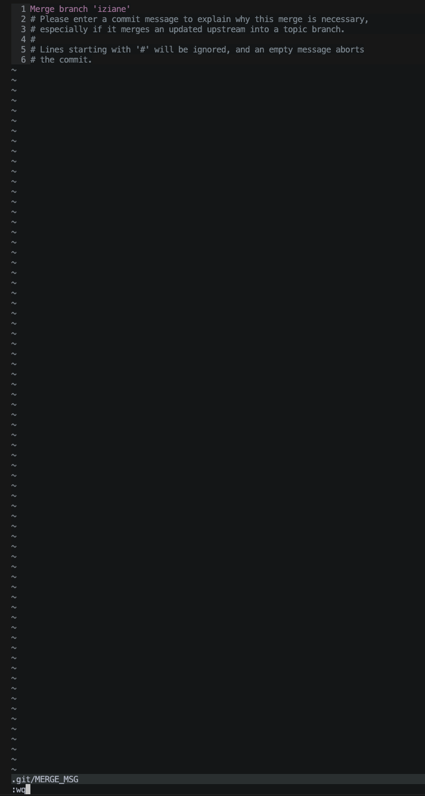

# Norm for Commits

Prefix format:

x = affected area, e.g. parsing, meaning:
    FEAT(parsing): Explanation of the commit

- FEAT(x) —> Add new feature
- FIX(x) —> Bug fix
- DOCS(x) —> Changes to documentation only
- STYLE(x) —> Formatting changes that do not affect code logic (e.g., norminette, indentation)
- REFACTOR(x) —> Code that neither fixes a bug nor adds a feature
- PERF(x) —> Changes that improve performance
- TEST(x) —> Add test (e.g shell script)
- BUILD(x) —> Frame, architecture of Project
- CHORE(x) —> Routine tasks, maintenance
- REVERT(x) —> Revert a previous commit

Example:

- FEAT(execution): Add execution frame for Buildins etc…


# Git Wokrflow:

## Always Work in Your Own Branch - Never Push Directly to Main
1. `git checkout -b name_task --> z.B iziane_parser`
2. only push here

## You have worked on your branch and now want to merge it into the main branch

1. `git checkout main`
2. `git pull origin main`
3. `git merge --no-ff feature-branch`
    - if merge conflicts appear, solve with concerned peer

    <details>
      <summary>Show Merge Process (after running <code>git merge --no-ff feature-branch</code>)</summary>

   

   ### Finish the merge in Vim
    1. Press `ESC`
    2. Press `SHIFT` + `:`
    3. Type `wq`
        - `w` = write (save)
        - `q` = quit
    4. Press `ENTER`
    5. Finished - merge completes

    </details>
4. `git push origin main`


## Context: (mostly after you merged your branch with main, you do the following) —> Get your Branch up to date (after peers added feature)

1. go to branch
    `git checkout <name of feature branch>`

[//]: # (    ```bash)
[//]: # (    ```)

2. `git fetch origin`
3. `git merge origin/main`
    1. if merge conflicts appear, solve with concerned peer

    
## Safe Integration Workflow (Testing Before Merging to Main)

**Context:**  
You want to merge your work into `main`, but you're not sure if your changes will break the work of others.  
To avoid issues, use a temporary integration branch:

1. `git checkout main`
2. `git pull origin main`
    - Make sure your local `main` is up to date.
3. `git checkout -b integration_<YourName>`
    - Create a safe testing branch.
4. `git merge <your_branch>`
    - Merge your feature into the integration branch.
5. Resolve merge conflicts here (if any).
6. Test or run the program in this branch.  
   **Only proceed if everything works correctly.**
7. `git push`
    - Optional: push the integration branch for backup
8. `git checkout main`
9. `git pull origin main`
10. `git merge integration_<YourName>`
    - Now merge the already tested branch into `main`.
11. `git push`
    - Main is now safely updated.
